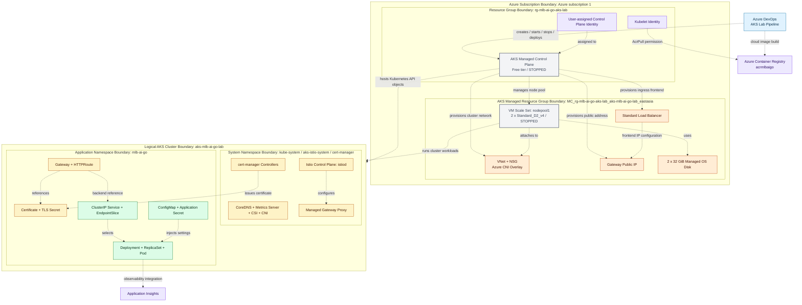
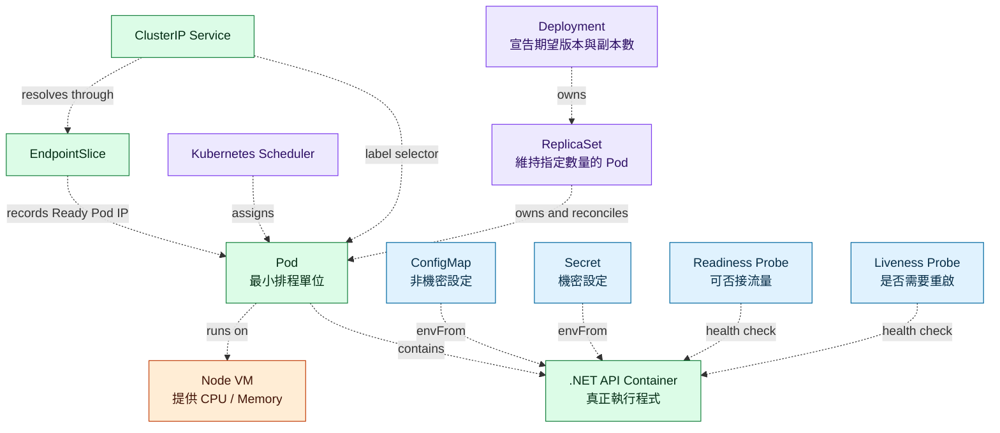
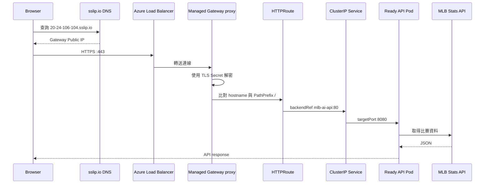
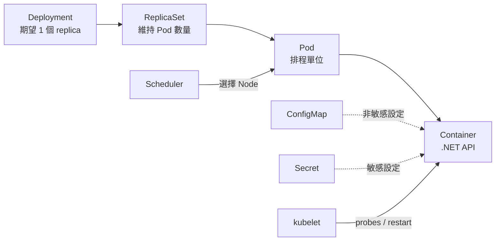
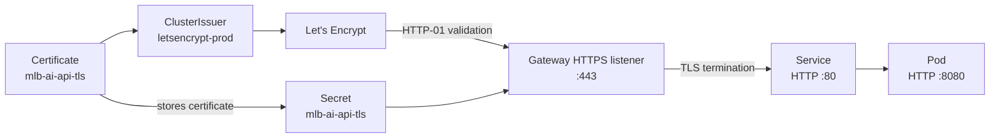
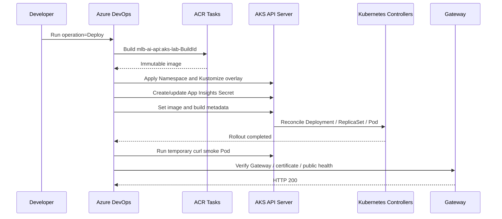

# AKS 目前完整架構

最後更新：2026-10-21

這份文件描述 AKS Lab 現在真正在 Azure 上的設定、停止前最後一次成功部署的 Kubernetes 資源，以及尚未補齊的部分。

## 先用一句話理解

AKS 可以想成一棟由 Azure 幫忙管理的大樓：

- Cluster：整棟大樓。
- Node：真正提供 CPU、記憶體的樓層。
- Pod：樓層裡可以被替換的工作位置。
- Container：坐在位置上，真正執行 .NET 程式的人。
- Gateway：大樓入口與警衛。
- HTTPRoute：警衛手上的分流規則。
- Service：永遠不變的內部分機。
- Deployment：規定現場應該保持幾個工作位置的主管。

使用者不用知道 Pod 現在在哪台 Node，也不用知道 Pod IP。請求只要交給 Gateway，Kubernetes 會一路轉交給健康的 Pod。

## 先看目前狀態

### Azure 現在可確認的狀態

| 項目 | 目前值 |
| --- | --- |
| Resource Group | `rg-mlb-ai-go-aks-lab` |
| AKS Cluster | `aks-mlb-ai-go-lab` |
| Region | East Asia |
| Power state | `Stopped` |
| Provisioning state | `Succeeded` |
| Kubernetes version | `1.35` |
| AKS tier | Free |
| Node pool | `nodepool1`, System mode |
| Node count | 2 |
| Node VM | `Standard_D2_v4` |
| OS disk | 每個 Node 32 GiB |
| Network | Azure CNI Overlay |
| Outbound | Standard Load Balancer |
| Identity | User-assigned identities |
| OIDC issuer | Enabled |
| Workload Identity | Enabled |

AKS 停止後，Node VM 不執行，Pod、Service 與 Gateway 也不能處理流量。Kubernetes 設定仍保留，重新 Start 後 control plane 和 node pool 會恢復。

### 停止前最後一次成功部署

| Kubernetes 資源 | 最後已知狀態 |
| --- | --- |
| Namespace | `mlb-ai-go` |
| Deployment | `mlb-ai-api`, 1 replica |
| Container | `mlb-ai-api`, port 8080 |
| Service | `mlb-ai-api`, ClusterIP port 80 |
| GatewayClass | `approuting-istio` |
| Gateway | `mlb-ai-api-gateway` |
| HTTPRoute | `mlb-ai-api`, PathPrefix `/` |
| TLS hostname | `20-24-106-104.sslip.io` |
| Certificate | `mlb-ai-api-tls` |
| Certificate issuer | `letsencrypt-prod` |
| Backend image | ACR 中的 `mlb-ai-api:aks-lab-<BuildId>` |

Public IP 與 hostname 是停止前的最後已知值。Cluster 或 Gateway 重建後 IP 可能改變，必須重新核對，不能永久假設仍是 `20.24.106.104`。

## 圖例與視角

為避免同一條虛線同時表示網路、設定與停止狀態，AKS 架構拆成三張專業視圖：

| 視圖 | 回答的問題 | 箭頭規則 |
| --- | --- | --- |
| Deployment Topology | 資源在哪個 Azure / Kubernetes 邊界內？ | 虛線只表示建立、管理、授權或包含關係 |
| Runtime Request Flow | 一次外部請求如何走到 Container？ | 實線只表示執行時資料流 |
| Kubernetes Ownership | Deployment、Pod、Service、設定如何互相配合？ | 虛線只表示控制、選取、注入或檢查 |

外框是 Scope Boundary（範圍邊界），不是流量。灰色 `[STOPPED]` 表示資源仍存在，但目前不執行工作負載。

## View 1：AKS Deployment Topology（部署拓撲）

這張圖用 Azure Resource Group 與 Kubernetes Namespace 清楚切出管理邊界，不描述 HTTP 請求。



專業上會把 `rg-mlb-ai-go-aks-lab` 稱為使用者管理的 Resource Group；`MC_...` 則是 AKS 自動建立的 Managed Resource Group。後者裡面的 VMSS、網路與磁碟不應隨意手動修改，應透過 AKS 設定管理。

## View 2：AKS Runtime Request Flow（執行時請求流）

這張圖完全不畫管理關係，只畫 Cluster 啟動且前端 API URL 指向 AKS 時，一次 HTTPS 請求的實際路徑。

```mermaid
flowchart LR
    Browser([Browser])
    DNS[sslip.io DNS]
    PIP[Azure Public IP]
    LB[Azure Standard Load Balancer]
    Proxy[Managed Istio Gateway Proxy<br/>TLS termination]
    Route[Gateway API HTTPRoute<br/>hostname + PathPrefix /]
    Service[ClusterIP Service<br/>80 to 8080]
    Endpoint[EndpointSlice<br/>Ready Pod IP]
    Pod[Ready Pod]
    API[.NET API Container<br/>port 8080]
    MLB[MLB Stats API]
    Insights[Application Insights]

    Browser -->|1. HTTPS| DNS
    DNS -->|2. resolves hostname| PIP
    PIP -->|3. TCP 443| LB
    LB -->|4. forwards| Proxy
    Proxy -->|5. decrypted HTTP| Route
    Route -->|6. backendRef| Service
    Service -->|7. chooses Ready endpoint| Endpoint
    Endpoint -->|8. Pod IP| Pod
    Pod -->|9. container port 8080| API
    API -->|10a. MLB requests| MLB
    API -->|10b. telemetry| Insights

    classDef actor fill:#dbeafe,stroke:#2563eb,color:#172554
    classDef network fill:#ffedd5,stroke:#c2410c,color:#431407
    classDef platform fill:#fef3c7,stroke:#b45309,color:#451a03
    classDef workload fill:#dcfce7,stroke:#15803d,color:#052e16
    classDef external fill:#ede9fe,stroke:#7c3aed,color:#2e1065

    class Browser actor
    class DNS,PIP,LB network
    class Proxy,Route platform
    class Service,Endpoint,Pod,API workload
    class MLB,Insights external
```



目前 Cluster 是 `STOPPED`，所以這條 Runtime Flow 暫時不通；正式前端仍連 Container Apps。圖保留的是 AKS 啟動時已驗證過的設計，不代表現在有流量進入 Pod。

## View 3：Kubernetes Ownership（管理與相依關係）

這張圖專門解釋 Kubernetes 為何有多層物件。所有虛線都是控制關係，不是封包流向。



### 三張圖要怎麼讀

1. 想在 Azure Portal 找資源，先看 Deployment Topology。
2. 想追查「瀏覽器為何打不到 API」，看 Runtime Request Flow，沿編號逐站檢查。
3. 想理解 Pod 為何被建立、如何取得設定、為何能接流量，看 Kubernetes Ownership。
4. 看見外框時，先讀它的完整標題；那是管理範圍，不是網路防火牆或請求路徑。
5. 看見虛線時，讀箭頭上的動詞，例如 `owns`、`selects`、`injects`，就能知道是哪種控制關係。

## 流量如何進到 Pod



### 為什麼不是直接連 Pod

Pod 名稱與 IP 都可能因重建而改變。Service 使用 label selector 找到 Ready Pod，對內提供固定 DNS：

```text
mlb-ai-api.mlb-ai-go.svc.cluster.local
```

Gateway 和 HTTPRoute 只需要指向 Service，不需要知道 Pod 現在叫什麼或在哪台 Node。

用生活例子來說：

| Kubernetes | 生活例子 |
| --- | --- |
| Pod IP | 某位員工今天坐的位置，換人或重建後可能改變 |
| Service | 公司固定的客服分機 |
| HTTPRoute | 哪一類電話要轉到哪個部門的規則 |
| Gateway | 公司總機與一樓入口 |

即使 Pod 被刪除並重建，Service 仍會找到新的 Pod，所以外部網址不需要跟著改。

## 應用程式部署關係



目前 Container 資源限制：

| 設定 | CPU | Memory |
| --- | ---: | ---: |
| Request | 100m | 128 MiB |
| Limit | 250m | 512 MiB |

- Request 是 Scheduler 安排 Pod 時保證預留的最低需求。
- Limit 是 Container 最多能使用的上限。
- Readiness 失敗時 Pod 不接 Service 流量。
- Liveness 連續失敗時 kubelet 重啟 Container。

### Deployment、ReplicaSet、Pod 為什麼要分三層

- Deployment 管版本與更新策略。它知道需要幾個 Pod，以及 image 應該是哪一版。
- ReplicaSet 管數量。它只在意現在有沒有維持指定數量的 Pod。
- Pod 是實際被排程到 Node 上的執行單位，壞掉時可以整個換掉。

Rolling Update 時，Deployment 會建立新的 ReplicaSet。新 Pod 健康後，再把舊 ReplicaSet 降到 0。Rollback 則是把先前的 ReplicaSet 再升回來。

目前應用 Deployment 固定為 1 replica，尚未建立應用自己的 HPA 或 PDB。Managed Gateway 產生的 proxy 資源可能有平台管理的 HPA/PDB，但那不是 MLB API 的自動擴縮。

## TLS 架構



TLS termination 發生在 Gateway。瀏覽器到 Gateway 是 HTTPS；Gateway 解密後，在 Cluster 內以 HTTP 呼叫 Service。

## Identity 與權限

### Control plane identity

`id-mlb-ai-go-aks-control` 供 AKS control plane 操作需要的 Azure 資源。

### Kubelet identity

`id-mlb-ai-go-aks-kubelet` 供 Node/kubelet 使用，目前最重要的權限是從 `acrmlbaigo` 拉取 private image。

### Azure DevOps service connection

`sc-mlb-ai-go-azure` 讓 AKS Lab Pipeline 可以操作 Azure、取得 kubeconfig、建立 image、套用 manifests 與執行 smoke test。

### Workload Identity

Cluster 已啟用 OIDC issuer 與 Workload Identity，但 MLB API Pod 目前仍沒有 Kubernetes ServiceAccount + Federated Credential，所以應用程式尚未使用 Workload Identity 存取 Azure OpenAI 或 Key Vault。

白話來說，三種 Identity 是三張不同的工作證：

| Identity | 工作證用途 |
| --- | --- |
| Control plane identity | AKS 管理員操作 Azure 基礎資源 |
| Kubelet identity | Node 去 ACR 倉庫領取 Container Image |
| Workload Identity | 未來讓 Pod 自己安全存取 Azure OpenAI 或 Key Vault |

現在前兩張已經在使用，第三張只把機制打開，還沒有真正發給 MLB API Pod。

## AKS Pipeline 做了什麼

AKS pipeline 是手動執行，`trigger: none`，支援：

| Operation | 用途 |
| --- | --- |
| Plan | 顯示預計使用的設定與成本相關資源 |
| Preflight | 驗證 quota、工具、manifest 與 Azure 權限 |
| Create | 建立 identities、AKS、node pool、Gateway API 能力 |
| Deploy | ACR build、Kubernetes deploy、rollout、smoke test |
| Stop | 停止 cluster 與 Node VM 計費主體 |
| Start | 恢復既有 cluster |
| Status | 查詢目前狀態 |
| Destroy | 刪除 AKS Lab 資源 |



## Kustomize 三層設定

```text
k8s/base
  Namespace + ConfigMap + Deployment + ClusterIP Service

k8s/overlays/gateway
  base + Gateway + HTTPRoute

k8s/overlays/gateway-tls
  gateway + ClusterIssuer + Certificate + HTTPS patches
```

這讓同一套應用可以依練習階段選擇：

1. 只有 Cluster 內部 API。
2. 加上公開 HTTP Gateway。
3. 加上免費 HTTPS 與憑證。

## 已完成與尚未完成

### 已完成

- 兩台 Node 的 AKS cluster。
- Azure CNI Overlay 與 Standard Load Balancer。
- ACR private image pull。
- Namespace、Deployment、ReplicaSet、Pod、Service。
- ConfigMap 與 Kubernetes Secret。
- Readiness、liveness、內部 smoke test。
- Self-healing、scale、rolling update、rollback 實驗。
- Managed Gateway API、Istio gateway controller。
- sslip.io、Let's Encrypt、cert-manager 與 HTTPS。
- Start、Stop、Status、Destroy 自動化。

### 尚未補到 AKS

- Azure OpenAI endpoint、deployment 與 API key 尚未注入 AKS。
- AKS API 目前會對 AI briefing 使用 preview fallback。
- API Deployment 尚未建立 HPA。
- API Deployment 尚未建立 PDB。
- Pod 尚未使用 Workload Identity 存取 Azure 服務。
- 尚未將 Secret 改成 Key Vault + Secrets Store CSI Driver。
- Application Insights 已接入，但 Gateway access log 與更完整 AKS monitoring 還可加強。

## 重新啟動後應先檢查

```bash
az aks start \
  --resource-group rg-mlb-ai-go-aks-lab \
  --name aks-mlb-ai-go-lab

az aks get-credentials \
  --resource-group rg-mlb-ai-go-aks-lab \
  --name aks-mlb-ai-go-lab \
  --admin \
  --overwrite-existing

kubectl get nodes
kubectl get pods -A
kubectl get all -n mlb-ai-go
kubectl get gateway,httproute,certificate -n mlb-ai-go
```

不要先假設原本 Public IP、TLS hostname 與 certificate 狀態仍有效；Start 後應重新查詢並執行外部 `/health` 測試。

