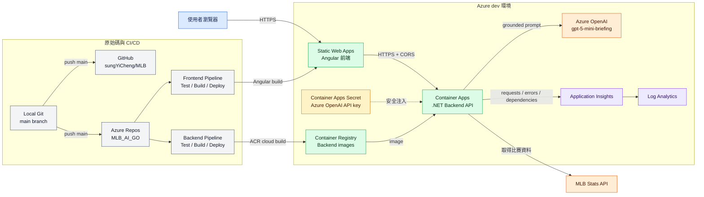
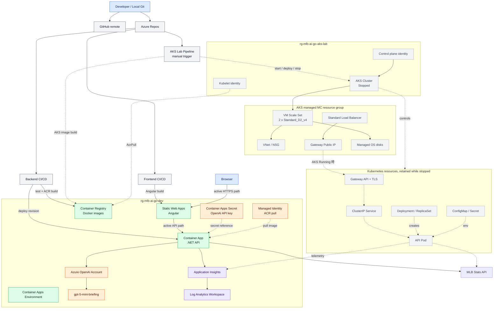
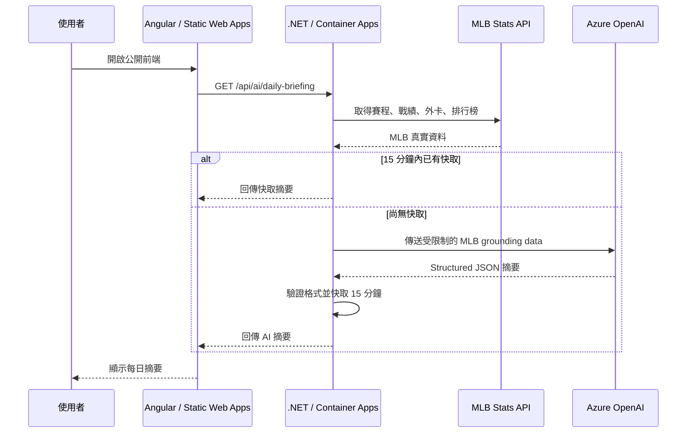
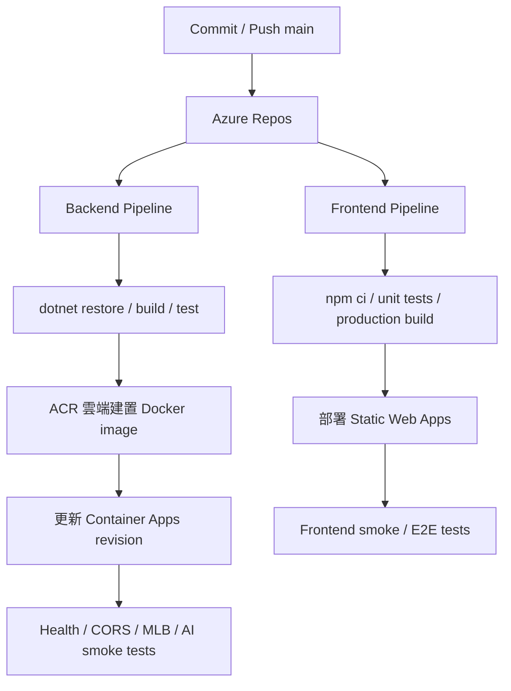
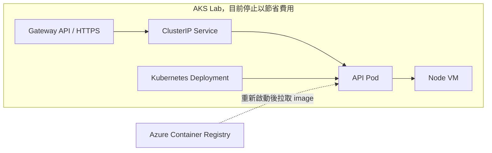

# MLB AI GO 目前架構總覽

最後更新：2026-10-20

## 一張圖看目前架構



## 詳細 Azure 資源關聯圖



實線是目前正式環境正在使用的路徑；虛線是 AKS Lab 已建立但因 Cluster 停止而暫時不處理流量的路徑。

### 白話版：現在到底誰在做什麼

| 元件 | 最直白的工作 |
| --- | --- |
| Static Web Apps | 把 Angular 畫面送到使用者瀏覽器 |
| Container Apps | 目前正式執行 .NET API，不需要自己管理 VM |
| MLB Stats API | 提供比賽、球隊與球員的原始資料 |
| Azure OpenAI | 把後端整理好的 MLB 資料寫成每日摘要 |
| Memory Cache | 15 分鐘內重複使用摘要，減少等待與 Token 費用 |
| ACR | 存放 Backend 的 Docker Image |
| Azure DevOps | 自動測試、建置 Image、部署與驗證 |
| Application Insights | 記錄 API 是否正常、速度多快、哪裡失敗 |
| AKS | Kubernetes 練習環境，目前停止，不承接正式流量 |

## 使用者打開網站時



如果 Azure OpenAI 逾時、限流或回傳不合法，Backend 會改用 deterministic preview，不讓整個頁面失效。

## CI/CD 部署流程



GitHub 是另一份遠端備份與公開原始碼位置；目前 Azure DevOps Pipeline 由 Azure Repos 的 `main` 觸發。

## AKS Lab 的位置



AKS 已完成建立、Pod 部署、Service、Gateway API、TLS、擴縮、rolling update 與 rollback 練習。目前 AKS 停止，所以正式前端不會打到 Pod，而是走 Container Apps。重新啟動 AKS 後，可以再將 production environment 的 API URL 切回 AKS 公開 HTTPS endpoint。

## 目前 Azure 資源分工

| 資源 | 目前用途 |
| --- | --- |
| Static Web Apps | 免費／低成本託管 Angular 靜態前端 |
| Container Apps | 目前正式執行 .NET Backend API |
| Container Registry | 保存 Pipeline 建好的 Backend Docker images |
| Azure OpenAI | 將 MLB 真實資料整理成每日 AI 摘要 |
| Application Insights | 記錄 API request、錯誤、延遲及外部 dependency |
| Log Analytics | 集中查詢與保存 Azure logs |
| Azure DevOps Pipelines | 自動測試、建置、部署及 smoke test |
| AKS | Kubernetes 學習環境，目前停止節省 Node VM 成本 |

## 目前最重要的兩條路

正式網站執行路徑：

```text
Browser -> Static Web Apps -> Container Apps -> MLB Stats API / Azure OpenAI
```

程式部署路徑：

```text
Local Git -> GitHub + Azure Repos -> Azure Pipelines -> ACR / Static Web Apps / Container Apps
```

